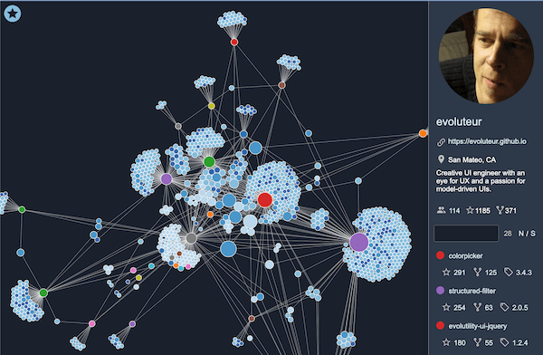
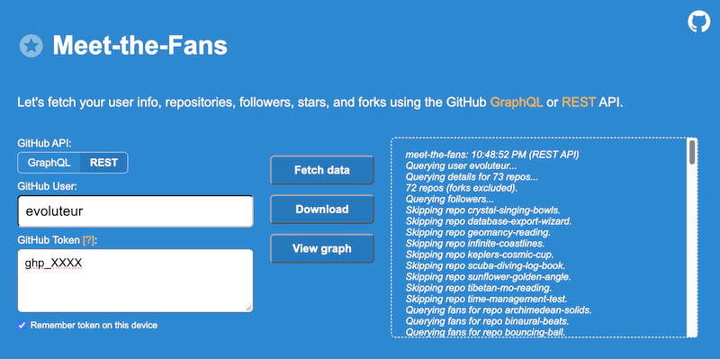
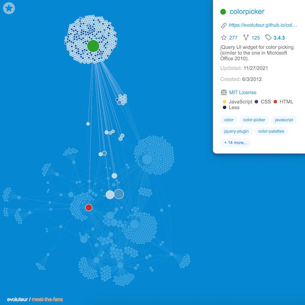

 &middot; [](https://github.com/evoluteur/meet-the-fans/blob/master/LICENSE)

Network graph of repositories, followers, stargazers, and forks to meet your GitHub fans.

Fetch your data and see your own graph right in the browser, with nothing to install or edit.

[](https://evoluteur.github.io/meet-the-fans/)
## Installation

[**Download**](https://github.com/evoluteur/meet-the-fans/archive/master.zip) or **clone** from [GitHub](https://github.com/evoluteur/meet-the-fans/).

```bash
# To get the latest stable version, use git from the command line.
git clone https://github.com/evoluteur/meet-the-fans
```


## Project structure

The two files you'll actually use are:

- `index-data.html` — fetches your GitHub data (see [Getting the data](#getting-the-data)).
- `index.html` — renders the graph: the demo data by default, or your fetched data with `index.html?data=mine` (see [Visualizing the data](#visualizing-the-data)).

## Getting the data

[Get your data](https://evoluteur.github.io/meet-the-fans/index-data.html) (user info, repositories, followers, stars, and forks) using the GitHub [GraphQL API](https://docs.github.com/en/graphql) or [REST API](https://docs.github.com/en/rest).

Open index-data.html in your browser to fetch and download your data easily:

1. Pick the API to use: **GraphQL** (default) or **REST**.
2. Enter your GitHub user name and your [GitHub Access Token](https://docs.github.com/en/authentication/keeping-your-account-and-data-secure/managing-your-personal-access-tokens) (a classic token with the `public_repo` scope).
3. Click the "Fetch data" button.

Note: since July 2026 GitHub only lists who starred a repo to its owner and collaborators ([GitHub changelog](https://github.blog/changelog/2026-06-30-upcoming-access-restrictions-to-public-api-endpoints-and-ui-views/)). A token with no scopes still gets the star counts, forks and followers, but an empty list of stargazers. Use a token with the `public_repo` scope, for your own repos.

Both APIs produce the same data file. GraphQL needs far fewer requests. REST needs one extra request per fan (to get their profile), but it also works without a token for very small accounts (GitHub allows only 60 unauthenticated REST requests per hour).

Your token stays in your browser: it is used only to call the GitHub API directly from your machine and is never sent to any server. The page remembers your user name and API choice. The token is kept only for the current browser tab, unless you check "Remember token on this device".

[](https://evoluteur.github.io/meet-the-fans/index-data.html)

The results are shown as syntax-colored JSON (use the copy icons to copy them). When fetching is done two buttons appear: "View graph" opens the graph with your data right away (it is saved in your browser and the graph opens as `index.html?data=mine`), and "Download" saves your data as a JS file.

Note: it is only fetching original repositories (not including forked repos) but it is easy to change in the code.

## Visualizing the data

[Visualize your data](https://evoluteur.github.io/meet-the-fans/) using D3 force layout.

There are two ways to see the graph of your own data:

1. **On the fly:** click "View graph" when fetching is done. Your data is saved in your browser (localStorage) and the graph opens as `index.html?data=mine`. You can come back to that link later without fetching again. The data stays only in that browser: another browser or computer will not see it (use Download for that).
2. **From the downloaded file:** to make your data the default, or to publish your graph, change the path "data/data-evoluteur.js" to the file you downloaded (in [index.html](https://github.com/evoluteur/meet-the-fans/blob/master/index.html)).

Clicking a project dot (on the graph or in the side pane) highlights it with its stargazers and forks.

The size of each user bubble grows on a log scale with the number of repos they starred or forked, so the most active fans stand out without hiding everyone else.

[](https://evoluteur.github.io/meet-the-fans/)

The graph supports zoom and pan. Colors, size and force layout can be configured in the [config.js](https://github.com/evoluteur/meet-the-fans/blob/master/config.js) file. You may also want to modify the [CSS](https://github.com/evoluteur/meet-the-fans/blob/master/css/meet-the-fans.css).

```javascript
const config = {
  // svg size
  height: 2000,
  width: 2000,
  // graph params
  strength: -30,
  distance: 50,
  // colors
  userColors: {
    follower: "#B9D7EB",
    star: "#86BDDC",
    fork: "#1966AC",
    both: "#4A96C9",
  },
  colorFaded: "#5f5f5f",
  circleBorder: "white",
  // misc.
  maxTopics: 5,
};
```

To rebuild the project (minimizing the JS), run the following commands:

```bash
npm install
npm run build
```

## License

Meet-the-Fans is released under the [MIT license](http://github.com/evoluteur/meet-the-fans/blob/master/LICENSE).

Already one of the fans? [Become a sponsor](https://github.com/sponsors/evoluteur) to keep the project growing.

## Related projects

You may also like these projects:

- [Repo-Atlas](https://github.com/evoluteur/repo-atlas) ([demo](https://evoluteur.github.io/repo-atlas/)) for a map of what a GitHub user has built: repos clustered by topic, stars over time, and the popular-but-stale ones flagged.
- [GitHub-Projects-Cards](https://github.com/evoluteur/github-projects-cards) ([demo](https://evoluteur.github.io/github-projects-cards/)) for a cards view of your Github projects.
- [npm-Pulse](https://github.com/evoluteur/npm-pulse) ([demo](https://evoluteur.github.io/npm-pulse/)) for a dashboard of the downloads, sparklines, and trends of your npm packages.

Copyright (c) 2026 [Olivier Giulieri](https://evoluteur.github.io/).
